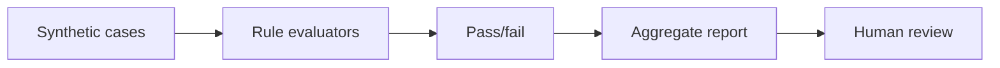

# AI Governance Lab
A reproducible rule-based evaluation harness for AI answer quality and privacy indicators.



Run from this directory with Python 3.10+:
```sh
python evaluate.py examples/cases.json
python -m unittest discover -s tests -v
```
Use --strict to fail a run containing failures or no cases. Cases specify required and forbidden phrases and an optional email-pattern check. Examples are synthetic and include intentional failures.

Limitations: exact phrase tests can be gamed; the email check is not a comprehensive PII detector; this tool does not establish semantic correctness, legal compliance or model safety. Future work includes calibrated human-reviewed rubrics, adversarial cases and versioned datasets.

AI-assisted educational portfolio prototype; not production-ready.
