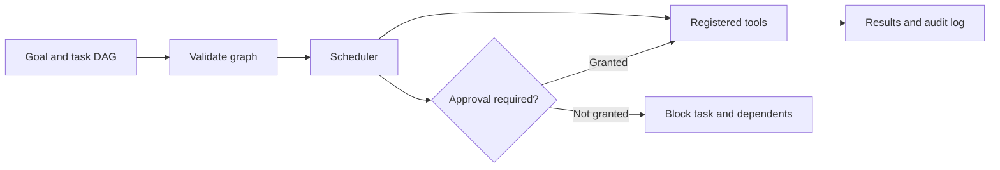

# AgentForge-AI
A dependency-aware agent workflow prototype with bounded retries, audit trails and human approval gates.



## Quick start
```sh
python agentforge.py
python agentforge.py --approve publish
```
The example produces a synthetic consulting brief. The publish task creates a local marker, not an external action. Tasks are manually defined and sequential; failed dependency tasks block downstream work. Retries require idempotent tools.

## Optional model-backed drafting
Set AI_CHAT_URL to a trusted chat-completions-compatible endpoint, AI_MODEL to the model name and AI_API_KEY if needed. Run `python agentforge.py --model`. Only synthetic context is sent. Keep keys in environment variables; never commit secrets. Live model compatibility and output quality have not been tested. No model text is executed as code.

Future work: automated planning, parallel execution, durable approval records and tool isolation.

## Project status
AI-assisted educational portfolio prototype; synthetic examples only. Review and adapt before claiming expertise. Not production-ready. Python 3.10+, standard library only.
Run tests from this project folder: `python -m unittest discover -s tests -v`.
