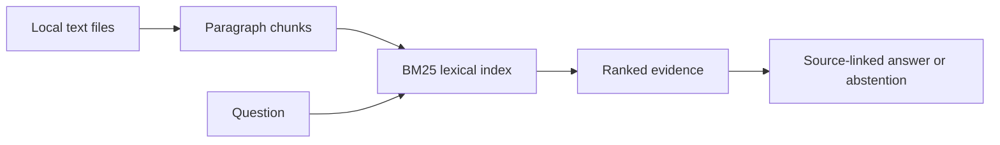

# Enterprise-RAG-Engine
An inspectable retrieval and grounded extractive QA baseline for enterprise knowledge documents.



## Quick start
```sh
python rag.py examples/docs "What is the retention period for audit logs?"
python rag.py examples/docs "When do we launch a spacecraft?"
```
The baseline uses lexical BM25 retrieval and returns direct excerpts with paragraph references. No embeddings or LLM generation are implemented. The abstention threshold is uncalibrated. It reads local text files only. The examples are fictional policies. Future work: compare hybrid retrieval and embeddings, measure recall@k and citation precision and enforce document-level permissions.

## Project status
AI-assisted educational portfolio prototype; synthetic examples only. Review and adapt before claiming expertise. Not production-ready. Python 3.10+, standard library only.
Run tests from this project folder: `python -m unittest discover -s tests -v`.
