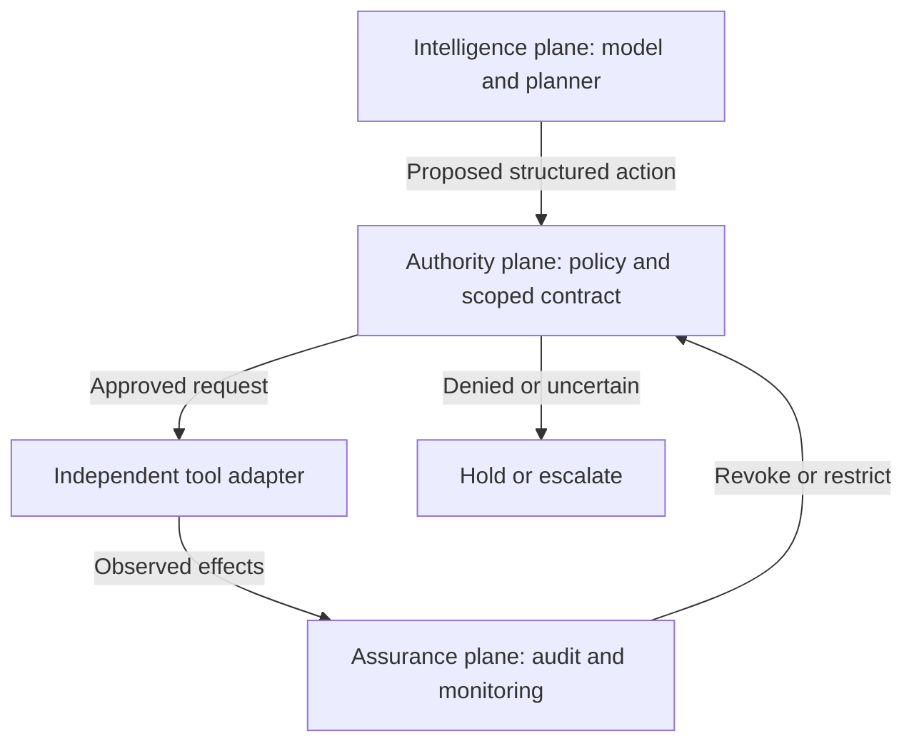

# GIF-10 reference architecture

Source: Beyond Superintelligence, version 1.0, pages 5–11.

The paper proposes ten control domains: intelligence alignment, autonomy, infrastructure, replication, security, behavioral monitoring, decision control, global governance, energy/resources and fail-safe architecture.

A proposed action contract includes task/workload identity, objective and owner, permitted operations and data, approved destinations, budget and expiry, risk tier, approvals, policy version and proof. Unknown, expired or excessive requests are denied or held. Delegated grants must be narrower than their parent. High-risk actions fail closed during policy outages.

The design assumes managed infrastructure and independent control channels. It does not guarantee containment of arbitrary future systems, uncontrolled copies or compromised operators. See the paper for full assumptions and limitations.
